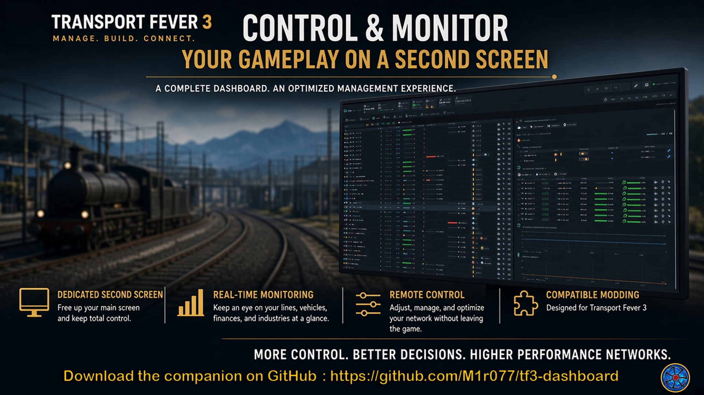

# TF3 Dashboard — Second Screen Dashboard for Transport Fever 3

Turn a second monitor into a live control room for your Transport Fever 3 company: finances, every line and
vehicle, stations, towns, industries, depots and alerts, with the game's own icons and history charts.
Optionally, manage the game from the dashboard (speed, camera, vehicles, stop configuration, terminals) while
the game stays full screen.

Everything runs locally on your PC. Nothing leaves your computer. No account, no installation, no admin rights.

**Get it:** mod [on mod.io](https://mod.io/g/transportfever3/m/second-screen-dashboard) · companion program on the [Releases](https://github.com/M1r077/tf3-dashboard/releases/latest) page (Windows and Linux).



<details>
<summary><b>中文简介</b> (Chinese summary)</summary>

**Second Screen Dashboard（第二屏仪表盘）** 把你的第二台显示器变成《Transport Fever 3》公司的实时调度中心：
资金、每一条线路和每一辆载具、车站、城镇、产业、车库和警告，全部使用游戏自带的图标，并带有历史曲线。
还可以在游戏保持全屏的同时，从仪表盘控制游戏：游戏速度、镜头、停止/启动/倒转载具、停靠点配置、停靠位。

- 一切都在本机运行，不会上传任何数据。不需要账号、不需要安装、不需要管理员权限。
- 由两部分组成：mod.io 上的模组（导出数据）+ 一个配套程序（Windows，自带 Python，解压即用）。
- 中文存档完全支持：中文的城镇、车站、线路和载具名称原样显示。
- 界面已有英文、法文、德文、巴西葡萄牙文，**中文界面目前只翻译了常用词**（标签页、表头、状态、按钮），其余仍为英文。
  欢迎母语者补全：只需修改两个文本文件（见下方 "Translating"），通过 Pull Request、GitHub issue 或 mod.io 评论提交均可，
  我们会把你的名字加入致谢。

下载：模组在 [mod.io](https://mod.io/g/transportfever3/m/second-screen-dashboard)，配套程序在 [Releases](https://github.com/M1r077/tf3-dashboard/releases/latest)。

</details>

## How it works

Two halves:

| Part | Where | What it does |
|---|---|---|
| **Mod `Second Screen Dashboard`** | [mod.io](https://mod.io/g/transportfever3/m/second-screen-dashboard) (in-game Mod Hub) or `mod/` in this repo | A Lua game script that writes a snapshot of the game state to `<userdata>/heightmaps/tf3dash_live.lua` every few seconds, and (if you enable it) executes commands written to `cmd.lua`. Uses only the official TF3 scripting API. Never modifies the savegame. |
| **Companion program (this repo)** | Your PC, Windows or Linux | `collector.py` watches `tf3dash_live.lua` / `tf3dash_slow_*.lua` and stores the history in a local SQLite database; `server.py` serves the dashboard at `http://127.0.0.1:8765/` in your browser. Python standard library only — the Windows release zip ships a bundled Python, Linux uses the system Python (3.10+); nothing to install. |

The mod alone does nothing visible; the companion alone has nothing to show. mod.io cannot distribute programs,
which is why the companion lives here.

## Install on Windows (3 steps)

1. **Mod** — in the game, open the Mod Hub, search *Second Screen Dashboard* ([mod.io page](https://mod.io/g/transportfever3/m/second-screen-dashboard)), subscribe, then enable it in your
   savegame's mod list (like any script mod — **subscribing is not enough, the mod must be ticked in the savegame**).
   Or copy `mod/tf3_dashboard_export` to `<userdata>\mods\` (see [docs/DETAILS.md](docs/DETAILS.md)).
2. **Companion** — download `TF3-Dashboard-<version>-windows.zip` from the
   [Releases](https://github.com/M1r077/tf3-dashboard/releases) page, unzip anywhere **except a cloud-synced folder**
   (OneDrive Desktop/Documents, Dropbox...): the history is a SQLite database and sync clients lock or duplicate it.
   `C:\TF3-Dashboard` or `D:\Games\TF3 Dashboard` are fine. Mod and companion are released together: mod revision 25
   goes with companion 0.16.x (older pairs keep working, the newest features simply stay blank).
3. **Run** — start the game with the mod enabled, then double-click `run_dashboard.cmd`. A window with two panes
   opens (collector | server) and your browser shows the dashboard. Put the browser on your second monitor,
   press `F11`. Close the window to stop everything.

Steam, Epic and GOG are supported; the game's userdata folder is detected automatically
(`<Steam>\userdata\<id>\3493540\local` or `%APPDATA%\Transport Fever 3`).

## Install on Linux

Works with the native Linux build and with the Windows build run through Wine / Proton — Heroic (native or
Flatpak), Steam (native build or Proton), Lutris, Bottles, plain Wine. Any distribution with Python 3.10+
(Arch/CachyOS: `python`, Debian/Ubuntu/Fedora: `python3`, usually preinstalled).

1. **Mod** — as on Windows: subscribe in the in-game Mod Hub and **enable it in the savegame's mod list**.
2. **Companion** — download `TF3-Dashboard-<version>-linux.tar.gz` from the
   [Releases](https://github.com/M1r077/tf3-dashboard/releases) page and unpack it outside a synced folder:
   `tar -xzf TF3-Dashboard-<version>-linux.tar.gz -C ~` -> `~/TF3-Dashboard`.
3. **Run** — start the game with the mod enabled, then `~/TF3-Dashboard/run_dashboard.sh` in a terminal. Collector
   and server run in that terminal (lines prefixed `[collector]` / `[server]`) and your browser shows the dashboard.
   Ctrl+C or closing the terminal stops everything. `run_dashboard.sh --install-desktop` adds a *TF3 Dashboard*
   entry to the application menu.

The userdata folder is found inside the Wine prefix (`…/drive_c/users/<user>/AppData/Roaming/Transport Fever 3`,
prefixes taken from Heroic's game settings, Steam's `compatdata/3493540`, Lutris, Bottles, `$WINEPREFIX`), in the
Steam userdata folder, or in `~/.local/share/Transport Fever 3` for the native build. The game's icons are read from
the installation Heroic or Steam reports. `python3 collector/tf3paths.py` prints everything that was found.

### Nothing shows up?

While the database is empty the dashboard displays a **checklist** that tells which link of the chain is missing:
game folder found → `tf3dash_live.lua` written by the mod → snapshots stored by the collector. The usual causes:

- the mod is subscribed but **not enabled in the savegame** (Mods menu of the savegame): no `tf3dash_live.lua`;
- the game is in the main menu: the mod only exports while a map is loaded;
- a **downloaded savegame** (mod.io, Workshop) does not take new mods until you have saved it once yourself: save, reload, and the export starts;
- **mod revision 8 or older with game build 40420 or newer** (the stability update of 8 October 2026): since that
  build the game only lets mods write to a few userdata folders, and the old mod wrote to its own
  `dashboard_export` folder; its log (`crash_dump\stdout.txt`) repeats `saveUserdata failed: The directory you
  trying to access is not available or invalid`. Update the mod to revision 9 (Mod Hub) and the companion to
  0.3.2: the export then lived in `towns_industries\tf3dash_*.lua`, a folder the game allows (since revision 27:
  `heightmaps`, see below). The checklist recognises this case;
- the game writes to another userdata folder than the one the companion watches (another Steam account, moved
  profile): the checklist reads the game's own log (`crash_dump\stdout.txt`) and shows the folder it uses (0.2.3+);
- the companion runs from OneDrive/Dropbox: see Install, move it;
- two companion windows are open (a second `run_dashboard.cmd` for a new map): the collector refuses to start
  twice on the same database and says so (0.7.5+; before, both wrote and the history got holes). Close the
  older window;
- the game is installed in an unusual place: create `config.json` (see Configuration).

If the browser shows a **blank page or an error** instead of the checklist: the companion window must be open
(the server pane says `Dashboard: http://127.0.0.1:8765/`), and something on your PC may be blocking local
addresses. Ad blockers with "block local network requests" (uBlock Origin's `block-lan` list, Brave Shields),
some VPN clients (Mullvad, NordVPN "Threat Protection") and Windows Firewall rules can cut `127.0.0.1`. Allow
`127.0.0.1:8765` in the blocker or disable it on that tab; if port 8765 is taken, set `"port"` in `config.json` (see Configuration).

The "TF3 Dashboard Collector" pane says the same thing in text, colour-coded: green = fine, yellow = waiting or
warning, red = something to fix. Once snapshots flow it prints one summary line per minute (errors are always
shown). When reporting a problem, copy the checklist or that pane, and the lines
containing `dashboard_export` from `stdout.txt` (that is the mod's log tag, the folder is `heightmaps`).

**Where the files are, and why there** (mod revision 27, companion 0.18.0): the game lets mods write to three
userdata folders only (`heightmaps`, `mod_presets`, `towns_industries`), no subfolders. `heightmaps` is the one
where no game list shows our files: the map editor only lists `.png` / `.tga` heightmaps there, while it lists every
file of `towns_industries` in its town/industry import, and the mod preset window every file of `mod_presets`. All
our files start with `tf3dash_`; your own files are never touched. The companion keeps the folder small: it deletes
the terrain files (`tf3dash_height_*`, ~1 MB each) once it has the relief, and removes what older revisions left in
`towns_industries` and `dashboard_export`. The mod removes its old `towns_industries` files at start too.

Running from source instead of the release archive: you need Python 3.10+ on the PATH (Windows:
`winget install Python.Python.3.12`; Linux: the distribution's `python3`). No pip, no venv, no packages.

### Remote control (optional)

In the game: Mods ▸ Second Screen Dashboard ▸ **Permit game control = On** (off by default). The dashboard
then shows the game controls (pause / speed, camera and saved camera views, vehicle actions, stop and terminal
editor on each line).
Every command does exactly what the matching click in the game does; nothing is ever bought, sold or demolished,
and no route is changed. The channel is a local file (`tf3dash_cmd.lua`) read by the mod four times a second.

## What you see

- **Operations** — fleet in service, load factor and average speed over time, per-carrier summary, stuck or idle
  vehicles, wear (service first), most unhappy and busiest lines, alerts with jump-to-entity.
- **Vehicles** — every vehicle with model icon, line, state, load, speed, condition, history on click. What the
  vehicle carries (mod revision 8): the cargo icons on board with counts, and what it was bought for. Filter by
  type or cargo. H or the "Horn" button sounds the horn.
- **Lines** — load, headway, waiting passengers/cargo, transported per year, the game's rating, history, and the
  **stop editor**: load mode, min/max waiting time, cargo filter (game icons), preferred and alternative terminals,
  whole-line actions (including the horn of every vehicle).
- **Map** — lines, vehicles, stations, industries, towns, headquarters (mod revision 8), alerts; click = camera on
  the object (a vehicle: follow it). With mod revision 11 the map draws the savegame's **geography**: shaded relief,
  sea, lakes and rivers, every road and track (bridges, tunnels), five map styles (gear button; mod revision 14 brings
  the **full-resolution terrain**, 4 m, with a satellite look: rock where it is steep, meadows below), and lines are drawn
  **along the network** (the real path of each vehicle, a predicted route until one has driven it). A **ruler** button measures as the crow flies, with the height difference and the distance the game actually pays (straight line + 8 x the climb, never the length of track), plus the distance by road and by rail over the existing network (dashed where nothing is built). **Cargo layers** (production / demand / stocks) draw the cargo icons next to each industry and town, dimmed by how far they are from their maximum; hovering shows the figures, and a vehicle shows what it carries. **Camera views**
  (mod revision 7): save the game camera under a name and recall it with one click or Shift+1..9; a view can be
  attached to a vehicle (revision 11: recalled = follow it again with the same framing). Views are kept
  per savegame in `db\camera_views.json`. **Travelling** (mod revision 10): smooth camera movements around a view
  (orbit, dolly, flyover, sweep, spiral), the chain of all views, and on each line's sheet a **line tour** - one
  flight over the line, its stops and where its vehicles are at that moment. The **Travellings** card keeps your
  favourite ones per savegame (subject + settings, up to 20), editable and replayable with one click. Drop music
  files in `music\` and they play with the travellings (in the browser; never part of the release); the game's own
  soundtrack is offered too, read straight from the game's `music.zip`.
- **Towns**, **Industries** and **Stations & depots** — tables with a detail card on click: capacities and
  satisfaction, production / shipped per cargo, waiting items and overflow, all over time (14 days of history).
- Every history chart runs on the **game's simulation clock** (a pause is a point, not a plateau; ranges in game
  months and years), and like the game the companion keeps **one timeline per save**: reloading an older savegame
  removes what had been recorded beyond it.
- **Finances** — balance, yearly result, transported, network size and company value over time, and the **game's own
  finance journal** (mod revision 13): the same table as the game's Finances window, by financial year, with every
  line (running costs and maintenance by carrier, upkeep of roads, tracks, buildings, income, construction and
  vehicle purchases), kept for the whole savegame, and a button that exports the lot as an Excel workbook - with the vehicle catalogue
  (every model the game knows, mod revision 22: years, speed, power, capacity per cargo, lifespan, price) and the
  income and costs of every line per financial year, with a pivot table and charts. Cards can be dragged and resized; the layout is saved per browser.
- **Line finances** (mod revision 23) — each line's balance over the last financial year in the Lines table, and in its
  card the income / running costs / balance per financial year over the whole game (the game itself shows 5 periods). Amounts
  in the game's colours, blue and salmon. Table columns can be reordered by dragging their header.
- **Layouts** — the arrangement of every tab plus the display sizes, as presets: *Default*, *Vertical screen* (for a
  portrait monitor) and your own; *Personal 1* always follows what you arrange. Copy a layout to the clipboard to share
  it, paste one you were given.
- **Settings ▸ Savegames and backups** — one backup = database + camera views for the current savegame; restore
  the views, or the whole database at the next start.
- **Settings ▸ Savegames** also shows the database size and lets you **forget** a save you no longer play (its
  history, camera views and travellings go; the game's savegame file is never touched).
- **Game closed?** The dashboard still works: it shows the last recorded situation of your save (an amber bar says
  so, commands are off) so you can plan the next session on the couch. With several saves in the database, pick the
  one to look at in Settings ▸ Savegames ("View"); the live game takes over again as soon as it writes.
- Languages: English, French, German, Brazilian Portuguese, Russian, partial Chinese — follows the game language automatically.

## Configuration

Nothing to configure in the normal case: the game's userdata folder (Steam: registry + `userdata`; Epic/GOG:
`%APPDATA%\Transport Fever 3`; Linux: Wine/Proton prefixes, Steam `userdata`, `~/.local/share`) and the game
installation (Steam libraries, Epic manifests, GOG registry, Heroic — used only to extract the icons) are detected
automatically. For unusual setups, copy `config.example.json` to
`config.json` and keep the keys you need:

```json
{ "export_dir": "C:\\Users\\<you>\\AppData\\Roaming\\Transport Fever 3\\heightmaps", "game_dir": "C:\\...\\Transport Fever 3", "port": 8765 }
```

Steam: `"export_dir": "C:\\Program Files (x86)\\Steam\\userdata\\<id>\\3493540\\local\\heightmaps"`
(mod revision 9+; with revision 8 or older on a game build before 40420 it was `...\\dashboard_export`, which the
companion still understands).
Linux paths are written as they are: `"export_dir": "/home/<you>/Games/Heroic/Prefixes/default/Transport Fever 3/drive_c/users/<you>/AppData/Roaming/Transport Fever 3/heightmaps"`.
`python collector/tf3paths.py` prints what is detected.

Mod settings (in-game): fast interval (time, finances, alerts, vehicles — default 2 s), slow interval (lines,
stations, towns, industries — default 30 s), export vehicles on/off, accept commands on/off, debug log.

In the game, a small **(i)** button in the mod button area (top left, next to the layers button) shows the state of
the export: green = running, red = the game could not write the files (with what to do), grey = starting; the window
also shows the export folder, when the companion was last seen, and the current settings (mod revision 10+).

## Performance and privacy

- Each snapshot is computed by the game's script thread and costs it some milliseconds (about 10-20 ms on a fast PC
  with a medium network, more on a slow PC or a big network). **If the game stutters at a regular rhythm after
  enabling the mod**, open the mod settings in the savegame and raise the fast interval (5 or 10 s), the slow interval
  (60 or 120 s); on very large networks disable the vehicle export. The defaults (2 s / 30 s) target a reasonably
  recent PC.
- **Big saves** (measured 17 Oct 2026 on a 1200-vehicle, 170-line save, Ryzen 9 9950X3D, fast speed): at 1 s / 10 s
  the mod took about 8 ms of a 60 ms frame; at **5 s / 60 s**, 3-4 ms. Most of the frame is the game's own simulation:
  the mod is not where the lag comes from. On the browser side, the live map with 1200 vehicles cost about 1.7 CPU
  cores, the other pages 0.2-0.3: switch the map off (round switch at the start of the Map toolbar) when you do not
  look at it - this also pauses the game's map-only work - or minimise the dashboard (a hidden tab does not refresh).
  Keep *Debug log* off.
- The database keeps per-snapshot detail for 2 hours, then one point per real minute (fleet and finance forever,
  each vehicle for 7 days) and one point per game day for lines, towns, stations and industries, kept for as long
  as the save exists - like the game's own logbooks. It compacts itself once an hour, so it stays in the tens of
  megabytes. Configurable, see `collector.py --help`.
- Smooth vehicle motion (Settings) animates the markers in the browser between two samples: about 1 ms per frame at
  60 fps with 300 vehicles, nothing on the game side. Off by default.
- The server listens on `127.0.0.1` only. Commands are refused from any other address, and from other websites
  open in the same browser (a request must come from the dashboard's own page).
- The game icons are extracted from **your** game installation at first start (`dashboard/extract_icons.py`); they
  are not redistributed.

## Repository layout

```
launch.py         starts collector + server, restarts them, opens the browser (used by run_dashboard.cmd / .sh)
build_release.py  builds the release archives into release/ (Windows zip, Linux tar.gz, mod zip)
collector/        collector.py (tf3dash_live.lua + tf3dash_slow_*.lua -> SQLite), luatable.py (Lua parser), tf3paths.py (folder detection), schema.sql
dashboard/        server.py (HTTP + JSON API), extract_icons.py, static/ (index.html, app.js, i18n.js, style.css)
mod/              the mod as published on mod.io (tf3_dashboard_export) — https://mod.io/g/transportfever3/m/second-screen-dashboard
docs/             see "Documentation" below
test/             make_fake_data.py + run_dashboard_demo.cmd / .sh (developer tool: simulated data, not in the release), i18ncheck.js
```

## Documentation

- [docs/DETAILS.md](docs/DETAILS.md) — full technical reference: the three parts, export files and schema, retention, savegames and backups, commands, publishing on mod.io, text encoding, SQL examples, alert codes.
- [docs/API_CATALOGUE.md](docs/API_CATALOGUE.md) — what the Transport Fever 3 modding API allows, section by section: done, doable, risky, impossible. Start here before asking for a feature.
- [docs/INTEGRATIONS.md](docs/INTEGRATIONS.md) — the rule for other mods (read their published data freely, ask before copying or writing), licences seen, candidates.
- [docs/TF3_SETTINGS_LUA.md](docs/TF3_SETTINGS_LUA.md) — unofficial reference of every key of the game's `settings.lua` (values, menu labels, hidden keys). Not about the dashboard; game knowledge gathered along the way.

## Translating

English, French, German and Brazilian Portuguese are complete; Chinese (`zh` / `zh_CN`) covers the frequent words
only and falls back to English for the rest — completing it is the most wanted contribution. Any other language is
welcome too. Two files, no build step:

- `dashboard/static/i18n.js` — the dashboard (about 420 short strings). Copy the `en: { ... }` block, rename it with
  the two-letter code (`es`, `ja`, ...), translate the right-hand sides; `{name}`-style placeholders stay as they are.
  Add an `<option value="es">Español</option>` in the `#lang` select of `dashboard/static/index.html`. For Chinese,
  the `zh` block at the end of the file already exists: add the missing keys to it (any key not listed falls back
  to English).
- `mod/tf3_dashboard_export/strings.json` — the mod settings and the in-game status window (27 strings). Same idea;
  the block name is the game's locale code (`zh_CN`, `es`, ...).

`node test\i18ncheck.js` lists any key missing or left empty. Open a pull request, or if git is not your thing, post
the two files on the mod.io page or in a GitHub issue and we will add them with your name in the credits. Partial
translations are fine: a missing key falls back to English.

## Building a release

`python build_release.py` (runs on Windows, Linux and macOS) assembles in `release/`:
`TF3-Dashboard-<version>-windows.zip` (companion + the official Python embeddable package, ~13 MB, downloaded once
into `release/cache/`), `TF3-Dashboard-<version>-linux.tar.gz` (companion without Python, ~2 MB) and
`tf3_dashboard_export-rev<N>.zip` (the mod for manual installation). `--targets windows,linux,mod` builds a subset.
Before any companion archive it runs `node test/i18ncheck.js` and `test/migrate_check.py` (Node.js needed); no
release if one fails.

Two independent version numbers:

- **companion**: `VERSION` in `dashboard/server.py` (shown next to the title in the dashboard). Semver-ish: patch
  (`0.1.x`) for fixes and small adjustments, minor (`0.x.0`) for new features, a new database schema or a dependency
  on a newer mod revision. Every version is a git tag `v<version>` and a GitHub release with its archives, never rebuilt
  afterwards.
- **mod**: `revision` in `mod/tf3_dashboard_export/mod.json`, bumped at each mod.io update only. The
  `tf3_dashboard_export-rev<N>.zip` is attached to a release only when the revision changed.

## License

GPL-3.0 — see [LICENSE](LICENSE). Transport Fever 3 is a trademark of Urban Games; this project is not affiliated
with Urban Games. Game assets are read from your own installation and never redistributed.
